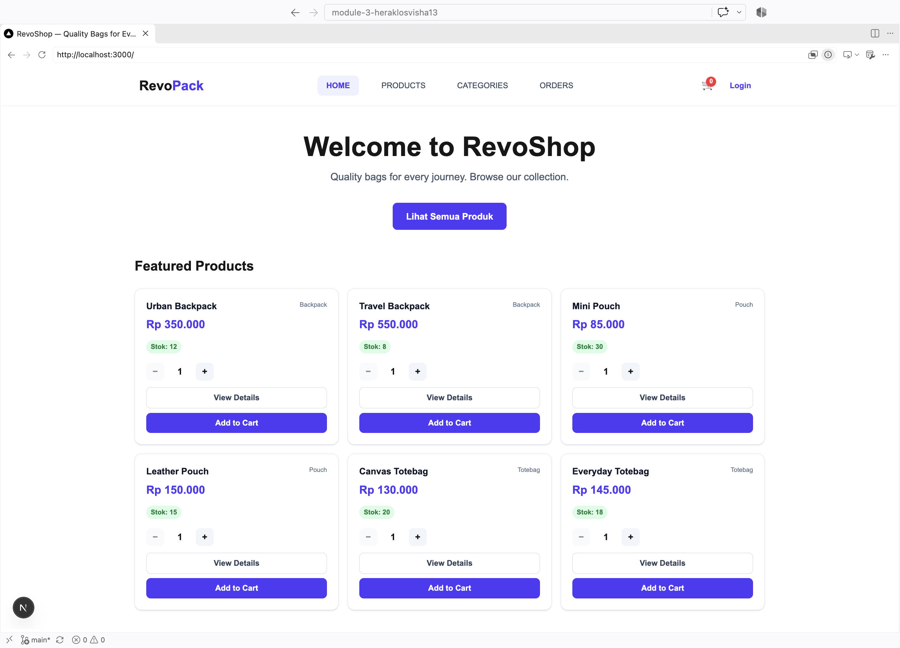
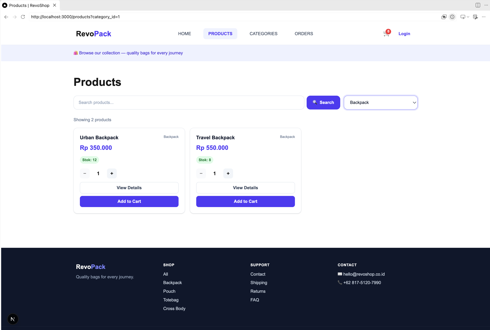
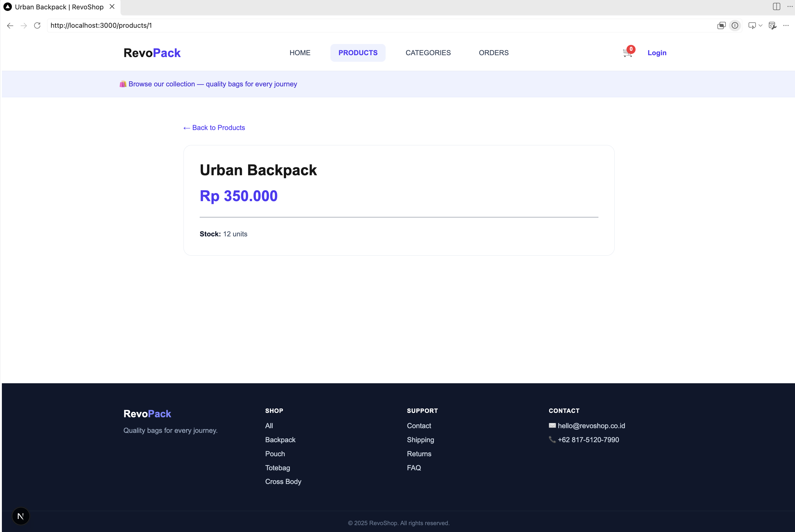
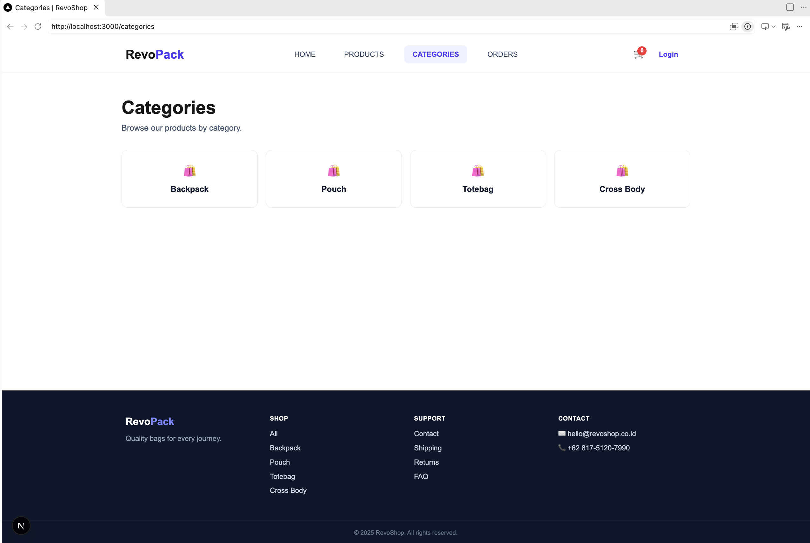
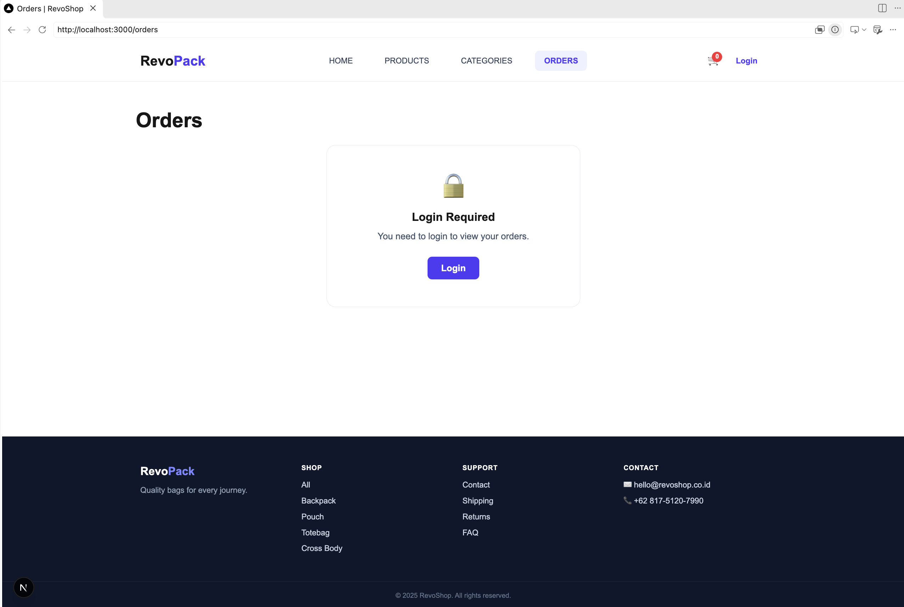
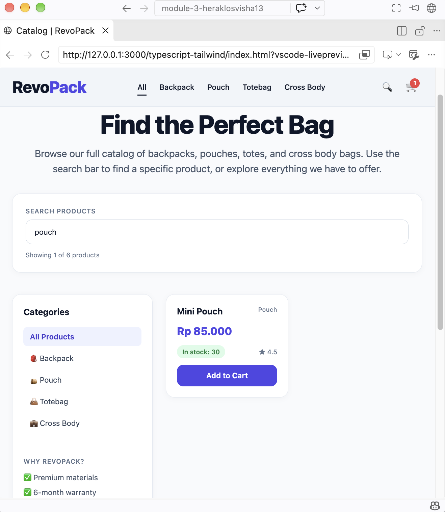
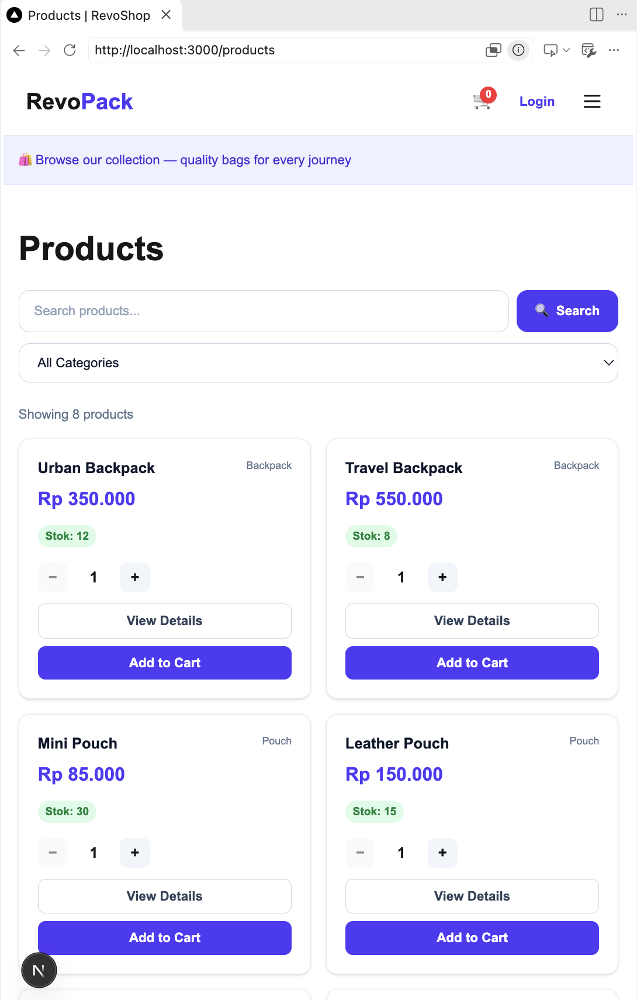

# Module 3 Frontend — RevoPack

## Project Overview

This repository contains the main project for the RevoU Full Stack Software
Engineering course, Module 3: **`revopack-project-next/`** — a RevoShop
storefront built with Next.js (App Router), React, TypeScript, and Tailwind CSS.
It fetches live data from a REST API for products, categories, and orders.

The project follows the RevoPack / RevoShop bag-store theme: backpacks, pouches,
totes, and crossbody bags.

## Folder Structure

```text
.
├── README.md
├── .gitignore
├── revopack-project-next/              # Next.js storefront
│   ├── app/
│   │   ├── layout.tsx                  # Root layout (Header + Footer)
│   │   ├── page.tsx                    # Home / featured products
│   │   ├── globals.css                 # Global styles / Tailwind
│   │   ├── favicon.ico
│   │   ├── components/                 # Shared UI components
│   │   │   ├── AddProductForm.tsx
│   │   │   ├── Card.tsx
│   │   │   ├── Footer.tsx
│   │   │   ├── Header.tsx
│   │   │   ├── ProductCard.tsx
│   │   │   └── SearchBar.tsx
│   │   ├── products/                   # Product list, filter, detail route
│   │   │   ├── CategoryFilter.tsx
│   │   │   ├── ProductList.tsx
│   │   │   ├── layout.tsx
│   │   │   ├── page.tsx
│   │   │   ├── loading.tsx
│   │   │   ├── error.tsx
│   │   │   └── [id]/                    # Dynamic product detail page
│   │   │       ├── page.tsx
│   │   │       └── loading.tsx
│   │   ├── categories/                 # Category grid
│   │   │   ├── page.tsx
│   │   │   ├── loading.tsx
│   │   │   └── error.tsx
│   │   └── orders/                     # Order history
│   │       ├── page.tsx
│   │       ├── loading.tsx
│   │       └── error.tsx
│   ├── lib/
│   │   ├── api.ts                      # Typed fetch helpers for the REST API
│   │   └── types.ts                    # Shared domain types
│   ├── public/                         # Static assets (svg icons)
│   │   ├── file.svg
│   │   ├── globe.svg
│   │   ├── next.svg
│   │   ├── vercel.svg
│   │   └── window.svg
│   ├── .env.local                      # NEXT_PUBLIC_API_BASE_URL
│   ├── next.config.ts                  # Next.js configuration
│   ├── next-env.d.ts                   # Next.js TypeScript declarations
│   ├── tsconfig.json                   # TypeScript configuration
│   ├── eslint.config.mjs               # ESLint configuration
│   ├── postcss.config.mjs              # PostCSS / Tailwind configuration
│   ├── package.json                    # Dependencies and scripts
│   ├── package-lock.json
│   └── README.md
└── screenshots/                        # Screenshots used in this README
```

The `.next/` and `node_modules/` folders are generated and excluded from version
control.

## RevoShop (Next.js)

A server-rendered storefront that reads products, categories, and orders from a
hosted REST API.

### Tech Stack

- Next.js 16 (App Router) with React 19
- TypeScript
- Tailwind CSS v4

### Features

- **Home page** with a hero section and a grid of featured products.
- **Products page** with full-text search and a category filter, both driven by
  URL query params so results are shareable and bookmarkable. Shows a result
  count and an empty state when nothing matches.
- **Product detail pages** on a dynamic `/products/[id]` route, with per-product
  metadata and a `not found` fallback for invalid IDs.
- **Categories page** that links each category back to a filtered product list.
- **Orders page** that lists order history, with a dedicated "login required"
  state when the API returns `401`.
- **Responsive header** with active-link highlighting and a mobile menu that
  closes after a selection.
- **Reusable product card** with stock status, a quantity stepper, disabled
  add-to-cart for out-of-stock items, and a link to the detail page.
- **Add product form** with client-side validation for name, price, stock, and
  category.
- Per-route `loading.tsx` and `error.tsx` for loading and error states.
- Prices formatted as Indonesian Rupiah with `Intl.NumberFormat`.

### Data Layer

`lib/api.ts` provides typed fetch helpers (`getProducts`, `getProduct`,
`getCategories`, `getOrders`, `getOrder`). The API wraps responses in a
`{ data, status }` envelope; `apiFetch` unwraps it and returns the typed `data`.
Shared domain types (`Product`, `Category`, `Order`, `OrderItem`, `User`) live in
`lib/types.ts`.

### Getting Started

The app expects an API base URL. Create `revopack-project-next/.env.local`:

```sh
NEXT_PUBLIC_API_BASE_URL=https://your-api-host.example.com
```

Then, from the project directory, install dependencies and start the dev
server:

```sh
cd revopack-project-next
npm install
npm run dev
```

Open [http://localhost:3000](http://localhost:3000) in a browser.

Available scripts (run from `revopack-project-next/`):

```sh
npm run dev     # Start the development server
npm run build   # Production build
npm run start   # Serve the production build
npm run lint    # Run ESLint
```

## Screenshots

### Home



### Products



### Product Detail



### Categories



### Orders



### Product Filtering


### Add to Cart



### Catalog Layout

Desktop:


Mobile:


### Mobile Form


